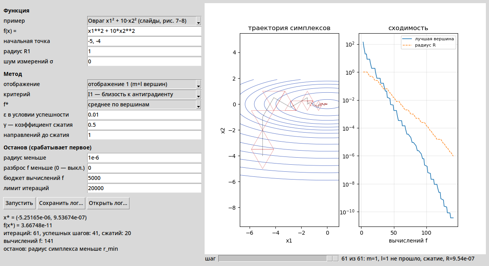

# Метод деформируемых конфигураций с правильным симплексом

Программа ищет минимум функции нескольких переменных методом поисковой оптимизации с правильными
симплексами (тема 7 курса «Введение в обработку больших данных»). Задаются исследуемая функция,
критерий выбора направления (I1–I7), правило отображения, условие успешности шага и правила
останова. Деформируемые симплексы не используются.



## Установка

Нужен Python 3.10 или новее (Tkinter входит в стандартную поставку).

```
pip install -r requirements.txt
```

## Запуск окна

```
python app.py
```

Слева — параметры, справа — линии уровня и траектория симплексов (для функций двух переменных)
и сходимость по числу вычислений f. Ползунок внизу показывает симплекс на любом шаге.
Подробно — в руководстве пользователя в отчёте.

Функция вводится формулой от `x1, x2, …`: `x1**2 + 10*x2**2`, `x1^2 + sin(x2)`.
Доступны `sin cos tan exp log sqrt abs arctan tanh pi e`. Начальная точка — числа через запятую,
в остальных полях дробь можно писать и с точкой, и с запятой.

## Запуск из консоли

```
python run.py experiments/configs/ravine.json
```

Конфиг — JSON с функцией, начальной точкой, радиусом и параметрами метода
(пример — `experiments/configs/ravine.json`, все параметры — класс `Settings` в `simplex/method.py`).
Лог шагов пишется в `experiments/results/<имя конфига>.csv`, рядом — JSON с постановкой и итогом.
Такой лог можно открыть в окне кнопкой «Открыть лог…».

## Эксперименты и проверки

```
python experiments/compare.py   # таблицы в experiments/results/, рисунок в experiments/figures/
python -m pytest tests          # нужен pytest
```

## Что где

| Путь | Что там |
|---|---|
| `simplex/geometry.py` | матрица B, построение правильного симплекса, проверка правильности |
| `simplex/mappings.py` | отображение 1 и 2 для m+l вершин, перебор направлений (m, l) |
| `simplex/criteria.py` | критерии I1–I7 |
| `simplex/method.py` | цикл метода: нумерация, выбор направления, успешность шага, сжатие, останов |
| `simplex/functions.py` | разбор формулы, подсчёт вычислений f, шум, примеры функций |
| `simplex/runlog.py` | лог прогона: CSV + JSON |
| `app.py` | окно |
| `run.py` | консольный запуск по конфигу |
| `experiments/` | конфиги, сценарий сравнения, результаты (данные к отчёту) |
| `tests/` | тесты |
| `docs/decisions.md` | принятые решения и их обоснование |

Проверено на Linux, Python 3.12.
